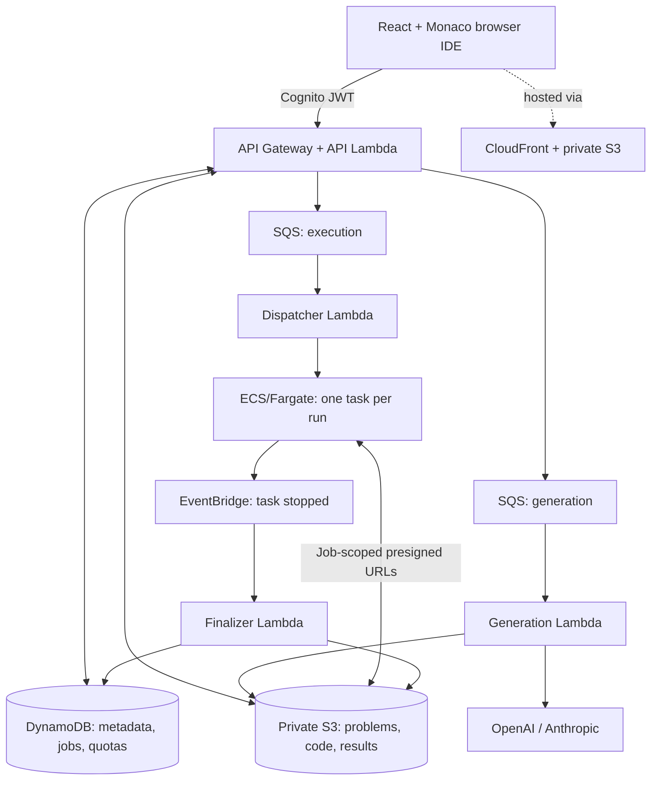

# SudoSolver Architecture

> **Status:** Planned MVP for CS 1660 / 2060. This document describes the target design; components may not be implemented yet.

## Overview

SudoSolver is an invite-only browser app for practicing practical Python software engineering interviews. Users can browse prebuilt problems or generate new ones with their own OpenAI/Anthropic API key, edit multiple files, run visible tests, submit against hidden tests, and resume saved work.

## System design



The browser polls `GET /jobs/{id}` for asynchronous generation and execution results. The diagram intentionally omits some IAM, networking, and deployment details.

## Components

| Component | Responsibility |
| --- | --- |
| **Frontend** | React/Monaco editor, file navigation, generation form, job polling, and result display. |
| **API** | Authentication/authorization, workspaces, problems, job creation, quotas, and submissions. |
| **Generator** | Calls OpenAI or Anthropic, validates the response, and packages generated problems. |
| **Runner** | Runs Python/pytest in a short-lived container and writes structured test results. |
| **Infrastructure** | Terraform for AWS resources; GitHub Actions for builds and manual deployment. |

## Core flows

**Generate problem:** Frontend → API → generation SQS → generation Lambda → LLM → validated problem package in S3 + metadata in DynamoDB → job status polled by frontend.

**Run or submit code:** Frontend → API → S3 submission snapshot + execution SQS → dispatcher → Fargate runner → S3 result → EventBridge/finalizer → DynamoDB job status → frontend polls for verdict.

- **Run** uses visible tests and may return per-test details.
- **Submit** uses hidden tests and returns a verdict/summary, never hidden test source.

## Data and problem packages

- **DynamoDB:** users, problem metadata/ownership, workspace pointers, jobs, submission history, and quotas.
- **Private artifacts S3 bucket:** problem packages, workspace snapshots, job inputs/results, and immutable submissions.
- **SSM Parameter Store SecureString:** user-supplied provider API keys.
- **Cognito:** invite-only accounts and verified user identity.

A problem package separates instructions, starter files, visible tests, hidden tests, and a reference solution. The browser receives only instructions, starter files, and visible tests; private test/reference artifacts remain server-side.

## Development layout (planned)

```text
frontend/              React + TypeScript + Monaco
backend/               Application API
services/generator/     AI generation and provider adapters
services/runner/        Dockerized Python/pytest runner
infra/                  Terraform modules and environments
examples/               Prebuilt Python problems
docs/                   API contracts and implementation notes
.github/workflows/      CI/CD
```

**Local-first workflow:** Run the frontend and API locally, mock AWS-facing adapters where practical, and execute test jobs in a local Docker container. Use AWS to validate the end-to-end asynchronous flow. Keep provider/model generation logic independently testable.

## Security and scope

- Derive user identity from verified Cognito tokens; check ownership on every private resource.
- Never send hidden tests, reference solutions, API keys, or privileged AWS credentials to the browser.
- Use least-privilege IAM, private S3 objects, per-job presigned URLs, and resource/time limits for execution.
- Treat generated files and submitted Python as untrusted input. A Fargate task with a trusted runner is **not** a hardened sandbox by itself; do not claim safety against arbitrary hostile code.
- Enforce per-user quotas and a global execution cap; handle duplicate messages, failed/stuck jobs, and retries safely.

**Out of scope for MVP:** languages beyond Python, external Python packages, a full terminal, public registration, multi-round interviews, AI code review, and production-grade hostile-code isolation.
